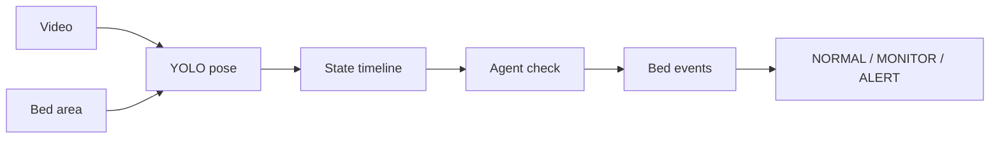

# newnop-carewatch

Watches one indoor video of an older person and reports what they are doing, whether they leave or return to bed, how long each activity lasts, and a simple decision: `NORMAL`, `MONITOR`, or `ALERT`.

It uses a ready-made YOLO pose model. No new model is trained.

## Run

```powershell
python -m venv .venv
.venv\Scripts\pip install -r requirements.txt
.venv\Scripts\python -m newnop_carewatch analyze --video data\videos\older_person_get_out_of_bed.mp4
.venv\Scripts\python -m newnop_carewatch evaluate --video data\videos\older_person_get_out_of_bed.mp4
```

For a new camera view, draw the mattress once:

```powershell
.venv\Scripts\python -m newnop_carewatch setup-bed --video data\videos\your_video.mp4
```

The pose model is `models/yolo26n-pose.pt`. The first run saves body measurements in `outputs/<video>/features.json`. Later runs reuse that file. Add `--fresh` to run YOLO again.

## How it works



YOLO finds the body 5 times a second. The patient is the person who spends the most time on the bed. Each moment is scored from body tilt, knee bend, speed, and whether the hips are on the bed. A timeline then keeps only possible changes, so lying cannot jump straight to walking. If a moment is unclear, the agent looks 10 seconds back and 10 seconds ahead before deciding. Weak evidence stays `UNKNOWN`.

States: `LYING_IN_BED`, `SITTING_ON_BED`, `SITTING_OUTSIDE_BED`, `STANDING`, `WALKING`, `LYING_OUTSIDE_BED`, `OUT_OF_BED`, `UNKNOWN`.

A bed exit needs: in bed, then standing, then moving away for at least 3 seconds. Sitting up or turning over is not an exit. A return needs the person to come back and settle on the bed.

| Decision | When |
|---|---|
| ALERT | Lying off the bed for 10 s, out of view for 3 min, or out of bed for 5 min |
| MONITOR | Left the bed and has not returned, sitting on the bed edge for 2 min, or `UNKNOWN` for 30 s |
| NORMAL | None of the above |

## This video

`data/videos/older_person_get_out_of_bed.mp4` is 21 seconds. The person lies down, rolls toward the edge, and sits up. They do not stand or leave, so there is no bed exit.

```text
00:00 – 00:17  LYING_IN_BED
00:17 – 00:21  SITTING_ON_BED
```

```json
{
  "total_observation_time": "21s",
  "activity_summary": { "lying_in_bed": "17s", "sitting_on_bed": "4s" },
  "bed_summary": { "time_in_bed": "21s", "time_out_of_bed": "0s", "bed_exit_count": 0 }
}
```

Decision: **NORMAL**.

| Check | Result |
|---|---|
| Accuracy | 95.2% |
| Lying duration error | 0.5 s |
| Sitting duration error | 0.5 s |
| False bed exits | 0 |

Files: `outputs/older_person_get_out_of_bed/`.

## Limits

1. A half-reclined pose can sit between lying and sitting. Here that costs 0.5 seconds.
2. If the legs are cropped, walking can look like standing.
3. If the joints cannot be seen, the result is `UNKNOWN` rather than a guess.
